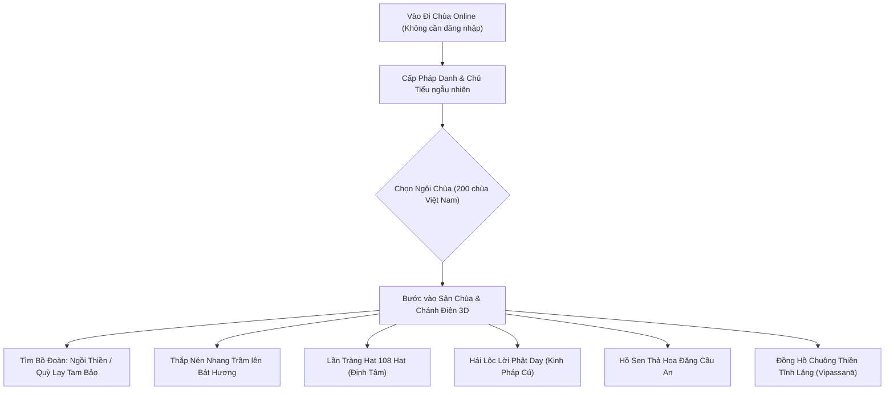

# ĐỀ ÁN THIẾT KẾ & XÂY DỰNG NỀN TẢNG: ĐI CHÙA ONLINE VIỆT NAM

> **Mục tiêu:** Xây dựng website "Đi Chùa Online" thuần Việt, trang nghiêm, thanh tịnh, phục vụ đồng bào và Phật tử khắp nơi vào chiêm bái, lạy Phật, tọa thiền, tĩnh tâm, kết nối tâm linh thiện lành.
> **Tiêu chuẩn kỹ thuật:** Chịu tải 10.000 – 50.000 người online đồng thời mà không giật lag, chi phí vận hành máy chủ gần như tối thiểu.

---

## I. TÔN CHỈ & BẢN SẮC CHÙA VIỆT

Khác với các ứng dụng giải trí thông thường, **Đi Chùa Online** được xây dựng trên nền tảng **Chánh kiến, Trang nghiêm và Văn hóa truyền thống Việt Nam**:

1. **Không gian Chùa Việt thuần khiết:**
   - **Chánh điện:** Mái ngói mũi hài, cột gỗ lim, hoành phi câu đối chữ thuần Việt thư pháp thanh nhã. Bàn thờ Tam Bảo trang nghiêm với tượng Đức Bổn Sư Thích Ca Mâu Ni, hoa sen, bát hương, đèn nến lung linh.
   - **Khuôn viên chùa:** Cây bồ đề rợp bóng, chuông đồng, khánh đá, hồ sen thả hoa đăng, sân chùa tĩnh mịch.
2. **Hình ảnh Chú Tiểu Việt Nam:**
   - Nhân vật 3D chú tiểu đầu tròn ngộ nghĩnh, khoác áo nâu sồng, áo lam cư sĩ thanh nhã, hoặc màu vàng hoại sắc truyền thống.
   - Mỗi người khi ghé chùa được tự động cấp một **Pháp danh thuần Việt ý nghĩa**: *Thiện Tuệ, Tuệ An, An Nhiên, Thiện Tâm, Minh Triết, Phúc An, Diệu Âm, Vô Ưu, Tịnh Lạc, Chân Không, Thong Dong...*
3. **Mạng lưới 200 Ngôi Chùa Danh Lam Thắng Cảnh khắp 3 Miền:**
   - Người dùng có thể chọn ghé thăm ngôi chùa tại quê hương hoặc ngôi chùa mình yêu thích:
     - **Miền Bắc:** Chùa Một Cột, Chùa Hương, Chùa Yên Tử, Chùa Bái Đính, Chùa Thầy, Chùa Trấn Quốc, Chùa Tam Chúc...
     - **Miền Trung:** Chùa Thiên Mụ, Chùa Từ Hiếu, Chùa Linh Ứng (Đà Nẵng), Chùa Cầu (Hội An), Chùa Long Sơn (Nha Trang)...
     - **Miền Nam & Miền Tây:** Chùa Hoằng Pháp, Chùa Vĩnh Nghiêm, Chùa Giác Lâm, Thiền Viện Trúc Lâm, Chùa Núi Bà Đen, Chùa Vĩnh Tràng...
4. **Không gian "Hợp tịch – Cùng hiện diện trong im lặng":**
   - **Tuyệt đối KHÔNG có khung chat chữ hay voice chat tự do.** Chùa là nơi tĩnh lặng, thanh tịnh. Mọi người nhìn thấy nhau cùng quỳ lạy, cùng thiền tọa, chào nhau bằng cái chắp tay búp sen chứ không có cảnh ồn ào, tranh cãi hay quảng cáo rác.

---

## II. DANH MỤC TRẢI NGHIỆM TÂM LINH THUẦN VIỆT



### 1. Thắp Nén Nhang Trầm & Đảnh Lễ Tam Bảo
- Người dùng điều khiển chú tiểu đến trước bàn thờ Tam Bảo, bấm **"Thắp Nhang"**: một nén nhang trầm ảo được cắm vào bát hương với làn khói mỏng nhẹ bay lên.
- Nút **"Lạy Phật"**: Chú tiểu phủ phục quỳ lạy trang nghiêm, đồng thời vang lên một tiếng chuông gia trì hoặc tiếng khánh ngân vang.

### 2. Tọa Thiền Tĩnh Lặng & Đồng Hồ Chuông Thiền (Vipassanā Timer)
- Người dùng tìm một tấm bồ đoàn trống, bấm vào để chú tiểu an tọa trong tư thế kiết già.
- Tích hợp chế độ **Đồng hồ thiền (10, 15, 30, 45, 60 phút)**: Màn hình giảm sáng (Zen Mode), chỉ còn tiếng chuông đầu giờ, chuông xả thiền và âm thanh suối reo/gió thoảng giúp người dùng ngồi thiền thật ngay tại nhà hoặc bàn làm việc.

### 3. Lần Tràng Hạt 108 Hạt (Digital Mala)
- Màn hình hiển thị chuỗi hạt gỗ bồ đề thanh nhã.
- Lướt nhẹ ngón tay qua từng hạt để định tâm (kèm âm thanh lách cách êm ái và rung phản hồi haptic trên điện thoại). Đủ 108 hạt thì vang một hồi chuông thanh thoát.

### 4. Hái Lộc Lời Phật Dạy (Trang nghiêm, bài trừ mê tín)
- Thay vì bốc quẻ bói toán, người dùng đến Cội Bồ Đề để rút một **"Thông điệp Tỉnh thức"** (Lời dạy từ Kinh Pháp Cú - Dhammapada) với lời giải thích ngắn gọn, khuyên con người sống thiện, giữ tâm bình an.

### 5. Hồ Sen Thả Hoa Đăng Cầu Nguyện
- Ra bờ hồ sen, người dùng thắp một ngọn đèn hoa sen giấy ảo trôi nhẹ trên mặt nước, gửi lời nguyện cầu sức khỏe, bình an cho cha mẹ, người thân và quốc thái dân an.

---

## III. BÍ QUYẾT KỸ THUẬT: ĐI CHÙA ONLINE CHO 10.000 – 50.000 NGƯỜI CÙNG LÚC

Dựa trên kinh nghiệm kiến trúc thực tế được đúc kết từ hệ thống *Đi Chùa Online* tại Việt Nam:

| Vấn đề kỹ thuật | Cách làm thông thường (Dễ sập / Tốn kém) | **Bí quyết Chùa Online Việt Nam (Siêu nhẹ, Siêu mượt)** |
| :--- | :--- | :--- |
| **Cơ sở dữ liệu (Database)** | Lưu vị trí, ghi nhận mỗi bước đi vào MySQL/MongoDB $\rightarrow$ nghẽn I/O ngay lập tức khi vài trăm người vào. | **⚡ Hoàn toàn No-DB cho Realtime Loop:** Mọi trạng thái vị trí, góc xoay, động tác chú tiểu nằm 100% trên **RAM** máy chủ, đọc/ghi tức thì không độ trễ. |
| **Ngôn ngữ Máy chủ (Backend)** | Dùng socket.io trên Node.js cồng kềnh, tốn nhiều GB RAM. | **🦀 Rust (hoặc Go) + WebSocket thuần:** Cực nhẹ. Thực tế đo đạc: 1.000 người online chỉ tốn khoảng **16 MB RAM**, 10.000 người cũng chỉ khoảng **150 MB RAM**! |
| **Phân bổ tải (Scalability)** | Dồn tất cả mọi người vào 1 thế giới to lớn $\rightarrow$ máy chủ quá tải xử lý va chạm. | **🧩 Chia nhỏ theo 200 ngôi chùa:** Mỗi chùa giới hạn tối đa 30 – 50 người (khớp với số bồ đoàn trong chánh điện). 200 chùa chạy song song độc lập. Đông thêm chỉ cần mở thêm chùa/phòng. |
| **Giao thức mạng (Networking)** | Gửi chuỗi JSON dài dòng 150 – 200 bytes mỗi gói tin. | **📦 Gói tin Nhị phân (Binary Pack) chỉ 9 bytes:** Đóng gói tọa độ dạng số nguyên (`userId, x, z, rot, action`), chỉ gửi khi có cử động, không spam mạng. |
| **Dung lượng 3D & Tốc độ tải** | Tải mô hình nặng vài chục MB khiến mạng 4G/điện thoại yếu bị đứng hình. | **💾 Cache phía Client + Baked Texture:** Toàn bộ cảnh chánh điện + chú tiểu nén dưới **3 MB** (Draco / Meshopt). Ánh sáng được bake sẵn, Three.js chạy 60 FPS trên mọi điện thoại. Lưu cache vào IndexedDB, lần sau vào là có ngay. |

---

## IV. SƠ ĐỒ HỆ THỐNG KỸ THUẬT

```mermaid
graph TB
    subgraph ClientSide ["Client (Trình duyệt Web: Di Động / Máy Tính)"]
        ThreeCanvas["WebGL Canvas (Three.js Low-poly)"]
        AudioEngine["Web Audio (Chuông, Kinh, Tiếng Mõ)"]
        WSHandler["WebSocket Client (Binary Buffer 9 bytes)"]
        LocalCache["IndexedDB (Lưu sẵn Model 3D & Cảnh Chùa)"]
    end

    subgraph EdgeDelivery ["Mạng Phân Phối Tĩnh (CDN Cloudflare / Vercel)"]
        WebFiles["HTML / CSS / JS / Assets (Dung lượng < 3MB)"]
    end

    subgraph RealtimeServer ["Cụm WebSocket Server (Rust / Go)"]
        WSGateway["WebSocket Gateway"]
        subgraph TempleInstances ["Quản lý 200 Ngôi Chùa Độc Lập"]
            Chua1["Chùa Một Cột (Tối đa 50 người)"]
            Chua2["Chùa Bái Đính (Tối đa 50 người)"]
            Chua3["Chùa Hoằng Pháp (Tối đa 50 người)"]
            ChuaN["... 200 Ngôi Chùa khác"]
        end
        RAMManager["Quản lý RAM State (150MB cho 10.000 kết nối)"]
    end

    EdgeDelivery -->|Tải lần đầu| LocalCache --> ThreeCanvas
    WSHandler <===>|Gói tin 9 bytes (15 Hz)| WSGateway
    WSGateway --> TempleInstances
    TempleInstances <--> RAMManager
```

---

## V. CẤU TRÚC GÓI TIN NHỊ PHÂN SIÊU NHẸ (9 BYTES)

Để gửi trạng thái di chuyển và hành động của chú tiểu qua WebSocket với băng thông tối thiểu:

```text
Offset | Kiểu dữ liệu | Mô tả               | Giá trị
-------|--------------|---------------------|--------------------------------------------
0 - 1  | Uint16       | User ID             | 0 - 65535
2 - 3  | Int16        | Vị trí X            | Tọa độ thực x 100 (độ chính xác centimet)
4 - 5  | Int16        | Vị trí Z            | Tọa độ thực x 100 (độ chính xác centimet)
6 - 7  | Int16        | Góc quay Y (Yaw)    | Góc quay x 100
8      | Uint8        | Trạng thái / Cử động| 0: Đứng | 1: Đi | 2: Ngồi | 3: Lạy | 4: Chắp tay
```
*Tổng dung lượng: Đúng 9 bytes.* Một kết nối 4G thông thường ở Việt Nam có thể nhận hàng trăm gói tin này mà không hề tốn dung lượng hay gây nóng máy.

---

## VI. LỘ TRÌNH THỰC HIỆN TỪNG BƯỚC

### Giai đoạn 1: Bản mẫu Chánh điện 3D (Prototype Client)
1. Dựng gian Chánh điện chùa Việt tối giản bằng Blender (Mái ngói, bàn thờ Tam Bảo, Phật Thích Ca, hàng bồ đoàn, lư hương).
2. Tạo nhân vật chú tiểu áo lam/nâu với 4 chuyển động: Đứng, Đi, Ngồi thiền, Quỳ lạy.
3. Chạy thử nghiệm trên Three.js (Hỗ trợ Joystick trên điện thoại và phím bấm trên máy tính).

### Giai đoạn 2: Máy chủ Multiplayer & 200 Chùa
1. Viết server WebSocket bằng Go hoặc Rust (hoặc Bun) chia phòng theo danh sách 200 chùa Việt Nam.
2. Kiểm tra đồng bộ hóa các chú tiểu đi lại, ngồi vào bồ đoàn cùng nhau.

### Giai đoạn 3: Tích hợp Nghi thức & Âm thanh
1. Đưa âm thanh chuông mõ thuần Việt, tiếng kinh Bát Nhã, Chú Đại Bi vào hệ thống.
2. Hoàn thiện giao diện Lần tràng 108 hạt và Đồng hồ tọa thiền (Vipassanā Timer).
3. Tích hợp Thông điệp Tỉnh thức (Kinh Pháp Cú) và Hồ sen Thả hoa đăng.
