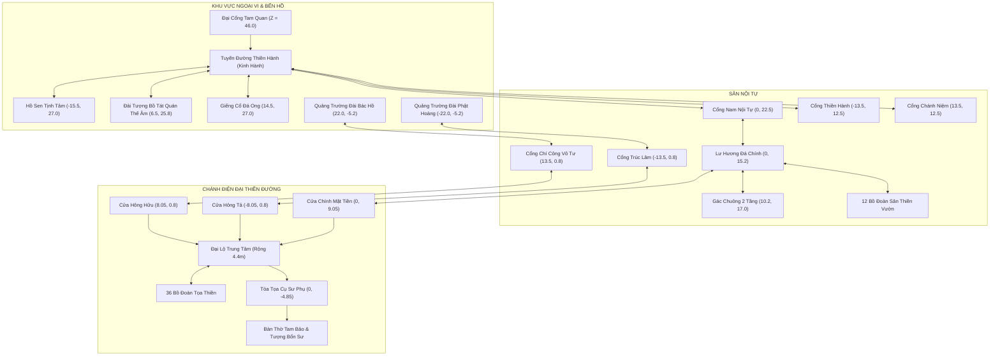

# 🪷 BẢN VẼ MẶT BẰNG TỔNG THỂ THIỀN VIỆN TRÚC LÂM (CHÙA ONLINE 3D)

> **Tài liệu Mặt Bằng Kiến Trúc & Quy Hoạch Không Gian Tọa Độ 3D**  
> Dự án: **Đi Chùa Online Việt Nam** (Tên miền: [thienvienonline.com](https://thienvienonline.com))  
> Hệ trục quy ước: **Trục X** (Tây `-X` ↔ Đông `+X`), **Trục Z** (Bắc `-Z` ↔ Nam `+Z`), **Trục Y** (Cao độ sàn).

---

## 1. Đồ Họa Mặt Bằng Tổng Thể (ASCII Architectural Floor Plan)

```text
                                  ══════════════ [ BẮC (-Z) ] ══════════════
                                      Rừng Trúc & Đại Sơn Hậu Viện (Z = -15.5)
┌────────────────────────────────────────────────────────────────────────────────────────────────────────────────────────┐
│                                                 ĐẠI TƯỜNG BAO BẮC (Z = -15.5)                                          │
│                                                                                                                        │
│   [TÂY (-X)]                                                                                             [ĐÔNG (+X)]   │
│                                                                                                                        │
│   ┌───────────────────────────────┐                  ┌──────────────────────────────┐                  ┌─────────────┐ │
│   │   ĐÀI TƯỢNG PHẬT HOÀNG        │                  │     CHÁNH ĐIỆN ĐẠI THIỀN     │                  │  ĐÀI TƯỢNG  │ │
│   │      TRẦN NHÂN TÔNG           │                  │            ĐƯỜNG             │                  │   BÁC HỒ    │ │
│   │  Tâm tượng: (-22.0, -5.2)     │                  │  ┌────────────────────────┐  │                  │  (22.0,-5.2)│ │
│   │  Lư hương:  (-22.0, -3.0)     │                  │  │   BÀN THỜ TAM BẢO      │  │                  │  Lư hương:  │ │
│   │                               │                  │  │  (Đức Bổn Sư Thích Ca)  │  │                  │  (22.0,-3.0)│ │
│   │  [o] [o] [o] [o]  (z = -1.2)  │                  │  └────────────────────────┘  │                  │ [o][o][o][o]│ │
│   │  [o] [o] [o] [o]  (z =  0.4)  │   Cửa Hông Tả    │   🧘 SƯ PHỤ TỌA CỤ (0,-4.85) │   Cửa Hông Hữu   │ [o][o][o][o]│ │
│   │  [o] [o] [o] [o]  (z =  2.0)  │  (-8.05, 0.8)    │                              │   (+8.05, 0.8)   │ [o][o][o][o]│ │
│   │  [o] [o] [o] [o]  (z =  3.6)  │       │          │   [o][o][o]    │    [o][o][o]│         │        │ [o][o][o][o]│ │
│   │   (16 Bồ đoàn ngoài trời)     │       │          │   [o][o][o]    │    [o][o][o]│         │        │ (16 Bồ đoàn)│ │
│   └──────────────┬────────────────┘       │          │   [o][o][o] ĐẠI LỘ  [o][o][o]│         │        └──────┬──────┘ │
│                  │                        │          │   [o][o][o] TRUNG   [o][o][o]│         │               │       │
│                  │      ┌─────────────────┴──────────┴───[o][o][o]  TÂM    [o][o][o]────┴─────────┴────────────┐  │       │
│                  │      │                                [o][o][o] 4.4M    [o][o][o]                            │  │       │
│                  │      │                                (36 BỒ ĐOÀN NỘI TỰ CHÁNH ĐIỆN)                         │  │       │
│   ĐƯỜNG ĐÁ       │      │                                                                                       │  │       │
│   KẾT NỐI        │      │   CỔNG TRÚC LÂM                         🚪 CỬA CHÍNH                   CỔNG CHÍ VÔ TƯ │  │       │
│   SANG TẢ        │      │   (-13.5, 0.8)                     TAM CẤP (0.0, 9.05)                 (+13.5, 0.8)   │  │       │
│   QUẢNG TRƯỜNG   ├──────┤        ▼                                    ▼                               ▼         ├──┤       │
│                  │      │ ═══════════════════╦════════════════════════════════════════╦════════════════════════ │  │       │
│                  │      │                    ║                                        ║                         │  │       │
│                  │      │                    ║             SÂN GẠCH NỘI TỰ            ║                         │  │       │
│                  │      │                    ║                    │                   ║      ┌───────────────┐  │  │       │
│                  │      │                    ║             [LƯ HƯƠNG ĐÁ CHÍNH]        ║      │  GÁC CHUÔNG   │  │  │       │
│                  │      │                    ║                (0.0, 15.2)             ║      │    2 TẦNG     │  │  │       │
│                  │      │                    ║                                        ║      │  Đại Hồng     │  │  │       │
│                  │      │                    ║       [o] [o]            [o] [o]       ║      │    Chung      │  │  │       │
│                  │      │                    ║       [o] [o] SÂN THIỀN  [o] [o]       ║      │ (10.2, 17.0)  │  │  │       │
│                  │      │                    ║       [o] [o]   VƯỜN     [o] [o]       ║      └───────────────┘  │  │       │
│                  │      │                    ║       (12 Bồ đoàn Sân gạch)            ║                         │  │       │
│                  │      │   CỔNG THIỀN HÀNH  ║                                        ║      CỔNG CHÁNH NIỆM    │  │       │
│                  │      │   (-13.5, 12.5)    ║                                        ║        (+13.5, 12.5)    │  │       │
│                  │      │        ▼           ║                                        ║              ▼          │  │       │
│                  │      └────────────────────╨───────────────── CỔNG NAM ─────────────╨─────────────────────────┘  │       │
│                  │                                            (0.0, 22.5)                                       │       │
│                  │                                                 ▼                                            │       │
│                  │    ┌─────────────────────────┐               ┌────────────────────┐ ┌──────────────────────┐ │       │
│                  │    │      HỒ SEN TỊNH TÂM    │               │ ĐÀI TƯỢNG QUÁN ÂM  │ │   GIẾNG CỔ ĐÁ ONG    │ │       │
│                  │    │       (R = 5.15m)       │               │ Tòa Sen: (6.5,25.8)│ │     (R = 1.45m)      │ │       │
│                  └────┤     Tâm: (-15.5, 27.0)  │               │ Lư hương: (6.5,27.4│ │  Tâm: (14.5, 27.0)   ├─┘       │
│                       │      Mặt nước hoa sen   │               │ [o][o][o][o] Bồđoàn│ │   Bờ đá ong rêu phong│         │
│                       └────────────┬────────────┘               └─────────┬──────────┘ └──────────┬───────────┘         │
│                                    │                                      │                       │                     │
│                                    └───────────────────┬──────────────────┴───────────────────────┘                     │
│                                                        │                                                                │
│                                      ĐƯỜNG THIỀN HÀNH KINH HÀNH CHÁNH NIỆM                                              │
│                                    (Vòng cung đá lát viền hoa cỏ qua trước đài Quan Âm)                                 │
│                                                        │                                                                │
│                                                        ▼                                                                │
│                       ═══════════════════════════════════════════════════════════════════════════                       │
│                                            ĐẠI CỔNG TAM QUAN CHÙA VIỆT                                                  │
│                                                    (Z = +46.0)                                                          │
│                          [Cổng Tả: Đạo Pháp]     [CỔNG CHÍNH: TRÚC LÂM]     [Cổng Hữu: Dân Tộc]                         │
│                                (X = -4.3)              (X = 0.0)                 (X = +4.3)                             │
│                       ═════════════════════════════════╤═══════╤═════════════════════════════════                       │
│                                                        │       │                                                        │
│                                                  BẬC ĐÁ XUỐNG BẾN HỒ                                                    │
└────────────────────────────────────────────────────────┴───────┴────────────────────────────────────────────────────────┘
                                      ĐẠI TƯỜNG BAO NGOẠI VI (Biên: X = ±37.5, Z = 46.0)
                                  ══════════════ [ NAM (+Z) ] ══════════════
```

---

## 2. Phân Vùng Không Gian Kiến Trúc & Bảng Tọa Độ 3D

Toàn bộ công trình gồm **3 phân vùng đồng tâm**, ngăn cách bằng hệ thống tường đá và cổng vòm khép kín:

### 2.1. Phân Vùng 1: Chánh Điện Đại Thiền Đường (`'hall'`)
- **Tọa độ bao viền:** Chiều ngang `X ∈ [-8.05, +8.05]` (rộng 16.1m); Chiều sâu `Z ∈ [-6.95, +9.05]` (dài 16.0m).
- **Cao độ sàn:** `HALL_FLOOR_Y = 0.45m` (cao hơn mặt sân 3 bậc tam cấp đá).
- **Bàn thờ Tam Bảo & Tượng Phật Bổn Sư:** Ngự tại cung Bắc trung tâm (`Z < -5.0`).
- **Tòa Tọa Cụ Sư Phụ:** Tọa độ `{ X: 0.0, Z: -4.85 }`, mặt hướng Nam nhìn bao quát đại chúng; có vùng đệm bán kính `R = 1.10m` chống va chạm.
- **36 Bồ đoàn Tọa thiền:** Xếp thành 6 hàng (`Z ∈ [-3.2, -1.6, 0.0, 1.6, 3.2, 4.8]`) × 6 cột (`X ∈ [-5.0, -3.6, -2.2, 2.2, 3.6, 5.0]`).
- **Đại lộ Trung tâm:** Khoảng trống giữa 2 dãy bồ đoàn rộng **4.4m** (`X = 0.0`) nối thẳng từ Bàn thờ Tam Bảo ra Cửa Chính.
- **3 Cửa Ra Vào:**
  - *Cửa Chính (Mặt Tiền):* `{ X: 0.0, Z: 9.05 }`, bậc tam cấp đổ ra sân tại `Z ∈ [9.05, 10.45]`.
  - *Cửa Hông Tả (Tây):* `{ X: -8.05, Z: 0.8 }`, bậc tam cấp đổ sang hành lang Tây.
  - *Cửa Hông Hữu (Đông):* `{ X: +8.05, Z: 0.8 }`, bậc tam cấp đổ sang hành lang Đông.

---

### 2.2. Phân Vùng 2: Sân Nội Tự (`'inner'`)
- **Tọa độ bao viền:** Chiều ngang `X ∈ [-13.5, +13.5]` (rộng 27.0m); Chiều sâu `Z ∈ [-7.0, +22.5]` (dài 29.5m).
- **Lư Hương Đá Chính:** Đặt tại `{ X: 0.0, Z: 15.2 }`, bán kính bát hương `0.95m`.
- **Gác Chuông 2 Tầng (Đại Hồng Chung):** Tọa độ tâm `{ X: 10.2, Z: 17.0 }`, bệ đá vuông bảo vệ `X ∈ [7.3, 13.1], Z ∈ [14.1, 19.9]`.
- **Sân Thiền Vườn:** 12 bồ đoàn ngoài trời bố trí 2 bên lư hương: `X ∈ [-6.0, -4.2, 4.2, 6.0]` × `Z ∈ [14.5, 16.2, 17.9]`.
- **5 Cổng Vòm Tường Rào Nội Tự:**
  1. *Cổng Nam Nội Tự:* `{ X: 0.0, Z: 22.5 }` (Hoành phi: *"CHÁNH NIỆM & BUÔNG BỎ"*).
  2. *Cổng Trúc Lâm Thiền (Tây Bắc):* `{ X: -13.5, Z: 0.8 }` (nối sang Đài Phật Hoàng).
  3. *Cổng Chí Công Vô Tư (Đông Bắc):* `{ X: +13.5, Z: 0.8 }` (nối sang Đài Bác Hồ).
  4. *Cổng Thiền Hành Đạo (Tây Nam):* `{ X: -13.5, Z: 12.5 }` (nối ra đường Kinh Hành phía Tây).
  5. *Cổng Chánh Niệm Đạo (Đông Nam):* `{ X: +13.5, Z: 12.5 }` (nối ra đường Kinh Hành phía Đông).

---

### 2.3. Phân Vùng 3: Khuôn Viên Ngoại Vi (`'outer'`)
- **Tọa độ biên Đại Tường Bao:** `X ∈ [-37.5, +37.5]` (rộng 75.0m); `Z ∈ [-15.5, +46.0]` (dài 61.5m).
- **Đài Tượng Phật Hoàng Trần Nhân Tông (Bên Trái):**
  - Tâm bệ tượng: `{ X: -22.0, Z: -5.2 }`.
  - Lư hương dâng hoa: `{ X: -22.0, Z: -3.0 }`.
  - 16 bồ đoàn ngoài trời (ma trận 4×4): `X ∈ [-25, -23, -21, -19]` × `Z ∈ [-1.2, 0.4, 2.0, 3.6]`.
- **Đài Tượng Chủ Tịch Hồ Chí Minh (Bên Phải):**
  - Tâm bệ tượng: `{ X: +22.0, Z: -5.2 }`.
  - Lư hương tưởng niệm: `{ X: +22.0, Z: -3.0 }`.
  - 16 bồ đoàn ngoài trời (ma trận 4×4): `X ∈ [19, 21, 23, 25]` × `Z ∈ [-1.2, 0.4, 2.0, 3.6]`.
- **Đài Tượng Bồ Tát Quán Thế Âm (Vườn Nam - Đối xứng Hồ Sen):**
  - Tâm bệ sen & Tượng: `{ X: +6.5, Z: 25.8 }` (Bệ đá 3 tầng tròn + Tòa Sen ngọc trắng, tượng Bạch Y cao 2.6m hướng Nam).
  - Lư hương đá dâng hoa: `{ X: +6.5, Z: 27.4 }`.
  - 4 bồ đoàn tọa thiền / quỳ lạy trước đài sen: `X ∈ [5.3, 6.1, 6.9, 7.7]` × `Z = 28.6`.
  - Sân đá hoa cương bát giác mở rộng: `X ∈ [4.2, 8.8]` × `Z ∈ [24.2, 29.8]`.
  - Cột đèn đá sân vườn 2 bên: `{ X: 3.9, Z: 27.4 }` và `{ X: 9.1, Z: 27.4 }`.
  - Đèn rọi ban đêm Spotlight vàng ấm chiếu tôn nghiêm vào Bồ Tát.
- **Hồ Sen Tịnh Tâm (Tây Nam):**
  - Tâm hồ nước: `{ X: -15.5, Z: 27.0 }`, bán kính mặt gương sen `R = 5.15m`.
- **Giếng Cổ Đá Ong (Đông Nam):**
  - Tâm giếng: `{ X: +14.5, Z: 27.0 }`, bán kính thành giếng `R = 1.45m`.
- **Đại Cổng Tam Quan (Phía Nam):**
  - Vị trí mặt tiền tại `Z = 46.0`.
  - Gồm 3 cửa: Cửa chính giữa `|X| < 1.75m` và 2 cửa phụ Tả/Hữu `3.15m < |X| < 5.45m`.

---

## 3. Sơ Đồ Lưu Chuyển Tuyến Đường (Mermaid Navigation Flow)



---

## 4. Bảng Tra Cứu Tọa Độ Cho Lập Trình Viên & AI

| Tên Khu Vực / Vật Thể | Mã Code Nút Mạng | Tọa Độ X (m) | Tọa Độ Y (m) | Tọa Độ Z (m) | Bán Kính / Vùng An Toàn |
| :--- | :--- | :---: | :---: | :---: | :---: |
| **Bàn Thờ Tam Bảo** | `altar_buddha` | 0.00 | 0.45 | -6.20 | Vùng linh thiêng bất khả xâm phạm |
| **Sư Phụ Tọa Thiền** | `SU_PHU_POS` | 0.00 | 0.45 | -4.85 | Cấm va chạm $R = 1.10\text{ m}$ |
| **Tâm Chánh Điện** | `n_hall_c` | 0.00 | 0.45 | 0.80 | Điểm giao cắt đại lộ và 2 cửa hông |
| **Cửa Chính Chánh Điện** | `n_hall_door_f` | 0.00 | 0.45 | 9.05 | Khe cửa rộng $3.10\text{ m}$ |
| **Cửa Hông Tả** | `n_hall_door_l` | -8.05 | 0.45 | 0.80 | Bậc tam cấp sang hành lang Tây |
| **Cửa Hông Hữu** | `n_hall_door_r` | +8.05 | 0.45 | 0.80 | Bậc tam cấp sang hành lang Đông |
| **Lư Hương Sân Chính** | `n_court_nl / nr` | 0.00 | 0.00 | 15.20 | Cấm va chạm $R = 0.95\text{ m}$ |
| **Gác Chuông** | `n_bell_court` | 10.20 | 0.00 | 17.00 | Bệ đá cấm leo $5.8\times 5.8\text{ m}$ |
| **Cổng Nam Nội Tự** | `n_gate_south` | 0.00 | 0.00 | 22.50 | Cổng vòm rộng $2.60\text{ m}$ |
| **Đài Phật Hoàng** | `dest_phat_hoang` | -22.00 | 0.00 | -5.20 | Bệ đá quảng trường $12\times 12\text{ m}$ |
| **Đài Bác Hồ** | `dest_bac_ho` | +22.00 | 0.00 | -5.20 | Bệ đá quảng trường $12\times 12\text{ m}$ |
| **Đài Tượng Quán Thế Âm** | `dest_quan_am` | +6.50 | 0.00 | 25.80 | Bệ đài sen cấm xuyên $R = 1.75\text{ m}$ |
| **Lư Hương Quán Thế Âm** | `STATIC_OBSTACLES`| +6.50 | 0.00 | 27.40 | Lư hương đồng/đá $R = 0.95\text{ m}$ |
| **4 Bồ Đoàn Quán Thế Âm** | `BD_POS (quan_am)`| 5.3 -> 7.7 | 0.00 | 28.60 | 4 bồ đoàn tọa thiền hướng Bắc |
| **Hồ Sen Tịnh Tâm** | `dest_ho_sen` | -15.50 | 0.00 | 27.00 | Mặt nước $R = 5.15\text{ m}$ |
| **Giếng Cổ Đá Ong** | `dest_gieng_co` | +14.50 | 0.00 | 27.00 | Thành đá $R = 1.45\text{ m}$ |
| **Đại Cổng Tam Quan** | `n_gate_tam_quan`| 0.00 | 0.00 | 46.00 | Cửa chính rộng $3.50\text{ m}$ |
